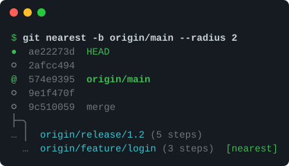

# git-nearest

A Git minimap centered on HEAD or another commit. Run `git nearest` for a compact branch overview,
or `git nearest -i` to follow the history one commit at a time.


<details><summary>as text</summary>

```console
$ git nearest
@  ae22273d  HEAD -> fix-typo  [1 staged, 1 untracked]
~  (1)
○  574e9395  origin/main  [nearest]
├─╮
~ │  (3)
│ │ ○  2cf4c0c2  origin/release/1.2
├─┼─╯
○ │  fc1afa3b  merge-base
~ │  (1)
│ ○  51eef8f5  origin/feature/login
│ ~  (2)
├─╯
○  5a42fea0  merge-base
~ (n) = n commits folded between
```
</details>

`@` marks the view center. The graph highlights the nearest branch tips and keeps merge-bases
visible. A row such as `~  (3)` folds three commits that you can expand as needed. The working tree
note next to HEAD shows whether there are staged, modified, untracked or conflicted files.

The example is generated from a synthetic repository. [Demo script](https://github.com/hwei/git-nearest/blob/main/scripts/demo.py)

## Install

Needs Python 3.8+ and git. No other dependencies.

```console
uv tool install git-nearest      # or: pipx install git-nearest
```

The package installs an executable called `git-nearest`; git runs any `git-<name>` on your `PATH` as
`git <name>`.

## Usage

```
git nearest [N] [-b REV] [--match REGEX] [--radius STEPS | --expand REV ...] [--details REV] [-i]
            [--no-status] [--color {auto,always,never}] [--no-color] [--version]
```

| | |
|---|---|
| `N` | number of distinct branch tips to label (default 5) |
| `-b`, `--branch REV` | center the view on this branch or commit (default HEAD) |
| `--match REGEX` | select branches by a regular expression on their full ref names |
| `--radius STEPS` | show all commits within this many parent or child steps (minimum 0, default 3 with `-i`) |
| `--expand REV` | show the fold below REV in the compact graph (repeatable) |
| `--details REV` | show the commit subject, author, time, SHA, and parents for REV |
| `-i`, `--interactive` | explore the graph with the keyboard |
| `--no-status` | skip the working tree check (it runs `git status`, which can be slow on huge repositories) |
| `--color` | `auto` (default) colors only on a terminal and respects `NO_COLOR` |
| `--version` | print the version and exit |

By default, the candidates are all remote-tracking branches. With `--match`, the pattern is
searched against the full ref names of local and remote-tracking branches. The filter applies before
selecting the nearest tips. Branches that point to the same commit share one place in the result.

```sh
git nearest --match '^refs/remotes/origin/(main$|release/)'
git nearest --match '^refs/heads/'
git nearest -b origin/main --expand origin/main --details origin/main
```

## Radius view

Each step crosses one real parent or child edge. `--radius 2` shows every known commit within two
steps of the center, including side branches and both parents of a merge when they are in range.
The `…` rows mark continuations at the edge of the map. A branch tip beyond the radius can appear
on a continuation with its exact shortest step count from the center.



<details><summary>as text</summary>

```console
$ git nearest -b origin/main --radius 2
●  ae22273d  HEAD
○  2afcc494
@  574e9395  origin/main
○  9e1f470f
○  9c510059  merge
├─╮
… │  origin/release/1.2 (5 steps)
  …  origin/feature/login (3 steps)  [nearest]
```
</details>

`--match` selects branch labels in this view. The commits and edges within the radius stay visible,
including paths from branches filtered out by name. The map starts from the local and remote-tracking
branch tips and the selected center. During a session, a direct jump can add the history of an
unreferenced commit.

## Interactive mode

Run `git nearest -i` in a terminal to start with a radius of 3. The arrows follow real edges from
`@`. At a fork, choose an edge with `←` or `→`, then repeat the direction or press `Enter` to step
onto that commit. The way back is preselected when available. Browse while the distant branch labels
load in the background.

| Key | Action |
|---|---|
| `↑` or `k` | Step to a child |
| `↓` or `j` | Step to a parent |
| `←` / `→` or `h` / `l` | Choose among multiple children or parents |
| `Enter` / `Esc` | Confirm or cancel the edge selection |
| `[` / `]` | Shrink or grow the radius |
| `g` | Jump to a branch or commit |
| `f` | Edit the branch regex filter or submit an empty value to clear it |
| `n` | Edit the number of branch tips to label |
| `Backspace` | Return to the previous view |
| `Home` | Return to the checked-out HEAD |
| `i` | Toggle commit details as you move |
| `q` or `Ctrl+C` | Quit and leave the final graph in the terminal |

Walking the graph is read-only. Press `Esc` to cancel a prompt or `Ctrl+U` to clear its input.
Quitting finishes the branch route search and prints the final graph into your terminal scrollback.
Use the same center, radius, filter, tip limit, and detail options to reproduce a view based on branch
history from the shell.

```sh
git nearest -b origin/main --radius 2 --match '^refs/remotes/origin/'
```

## How it works

The compact graph ranks tips by the fewest commits
exclusive to the view center, then the fewest commits exclusive to the tip. A branch that has absorbed
the center's history through a merge can rank above the branch it originally split from. The graph
shows newest commits first while keeping children above their parents. Fold counts show how many
commits are hidden in that section of the graph.

The radius view ranks tips by shortest distance across parent and child edges. Branches sharing a tip
share one label slot in either view.

Remote-tracking branches come from your local repository. Run `git fetch` to update them.
If no branches match, the graph still shows the view center and any commits within the selected radius.

## Similar tools

- Scripts based on `git show-branch` or on grepping `git log --decorate` for `origin/` (the usual
  Stack Overflow answers) look only at the first decorated ancestor, so they miss ties.
- [Git Town](https://www.git-town.com/) records a parent for each branch when it creates the branch.
  That is exact but only works for branches it knows about; `git-nearest` infers from history and needs
  no setup.

## Development

```console
uv run pytest
```

## License

MIT
