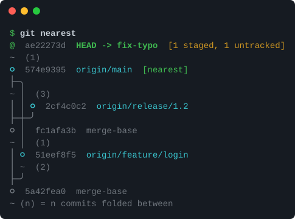

# git-nearest

A compact Git graph of the branches closest to HEAD or another commit. Run `git nearest` for a
quick view of the neighborhood, or `git nearest -i` to explore it in your terminal.



<details><summary>as text</summary>

```console
$ git nearest
@  ae22273d  HEAD -> fix-typo  [1 staged, 1 untracked]
~  (1)
○  574e9395  origin/main  [nearest]
├─╮
~ │  (3)
│ │ ○  2cf4c0c2  origin/release/1.2
├─┼─╯
○ │  fc1afa3b  merge-base
~ │  (1)
│ ○  51eef8f5  origin/feature/login
│ ~  (2)
├─╯
○  5a42fea0  merge-base
~ (n) = n commits folded between
```
</details>

`@` marks the view center. The graph highlights the nearest branch tips and keeps merge-bases
visible. A row such as `~  (3)` folds three commits that you can expand as needed. The working tree
note next to HEAD shows whether there are staged, modified, untracked or conflicted files.

The example is generated from a synthetic repository. [Demo script](https://github.com/hwei/git-nearest/blob/main/scripts/demo.py)

## Install

Needs Python 3.8+ and git. No other dependencies.

```console
uv tool install git-nearest      # or: pipx install git-nearest
```

The package installs an executable called `git-nearest`; git runs any `git-<name>` on your `PATH` as
`git <name>`.

## Usage

```
git nearest [N] [-b REV] [--match REGEX] [--expand REV]... [--details REV] [-i]
            [--no-status] [--color {auto,always,never}] [--no-color] [--version]
```

| | |
|---|---|
| `N` | number of distinct branch tip commits to show (default 5) |
| `-b`, `--branch REV` | center the view on this branch or commit (default HEAD) |
| `--match REGEX` | select branches by a regular expression on their full ref names |
| `--expand REV` | show the commits in the fold below REV (repeatable) |
| `--details REV` | show the commit subject, author, time, SHA, and parents for REV |
| `-i`, `--interactive` | explore the graph with the keyboard |
| `--no-status` | skip the working tree check (it runs `git status`, which can be slow on huge repositories) |
| `--color` | `auto` (default) colors only on a terminal and respects `NO_COLOR` |
| `--version` | print the version and exit |

By default, the candidates are all remote-tracking branches. With `--match`, the pattern is
searched against the full ref names of local and remote-tracking branches. The filter applies before
selecting the nearest tips. Branches that point to the same commit share one place in the result.

```sh
git nearest --match '^refs/remotes/origin/(main$|release/)'
git nearest --match '^refs/heads/'
git nearest -b origin/main --expand origin/main --details origin/main
```

## Interactive mode

Run `git nearest -i` in a terminal. The initial view comes from the same options as command mode.
Use the keys below to change that view. Quitting prints the final graph into your terminal scrollback.

| Key | Action |
|---|---|
| `↑` / `↓` or `k` / `j` | Select a commit or fold |
| `Enter` | Center the view on the selected commit |
| `g` | Jump to a branch or commit |
| `f` | Edit the branch regex filter |
| `n` | Edit the number of distinct tips to show |
| `Backspace` | Return to the previous view |
| `Home` | Return to the checked-out HEAD |
| `Space` | Expand or collapse the selected fold |
| `i` | Toggle details for the selected commit |
| `q` | Quit and leave the final graph in the terminal |

Centering the view is a read-only operation. Press `Esc` to cancel a prompt or `Ctrl+U` to clear its
input. Use the command-line options to render the same view directly from the shell.

## How it works

Git records ancestry through commits. The closest tip is the one that leaves the fewest commits
exclusive to the view center, then the fewest commits exclusive to the tip. A branch that has absorbed
the center's history through a merge can rank above the branch it originally split from. The graph
shows newest commits first while keeping children above their parents. Fold counts show how many
commits are hidden in that section of the graph.

Remote-tracking branches come from your local repository. Run `git fetch` to update them.
If no branches match, the graph still shows the view center.

## Similar tools

- Scripts based on `git show-branch` or on grepping `git log --decorate` for `origin/` (the usual
  Stack Overflow answers) look only at the first decorated ancestor, so they miss ties.
- [Git Town](https://www.git-town.com/) records a parent for each branch when it creates the branch.
  That is exact but only works for branches it knows about; `git-nearest` infers from history and needs
  no setup.

## Development

```console
uv run pytest
```

## License

MIT
